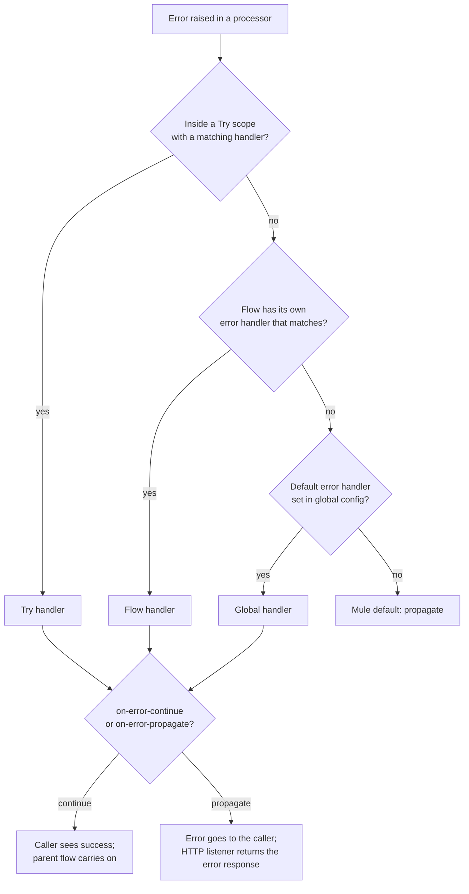

# Error Handling Patterns on Mule 4

Small, runnable Mule 4 flows that each isolate one error-handling behaviour, so the behaviour can be seen in the logs and the HTTP response. One flow per question, one HTTP endpoint per flow.

## What it demonstrates

**`src/main/mule/error-handling/`**

| File | Endpoints | Shows |
|---|---|---|
| `error-fundamentals.xml` | `/errors/raise`, `/errors/connectivity`, `/errors/continue-vs-propagate/continue`, `/errors/continue-vs-propagate/propagate` | `raise-error`, connector errors, `on-error-continue` vs `on-error-propagate` |
| `error-matching.xml` | `/errors/matching/by-type`, `/errors/matching/by-condition`, `/errors/matching/hierarchy` | Matching by type, by `when` expression, and through the error-type hierarchy |
| `error-custom.xml` | `/errors/custom` | Custom error types in an application namespace |
| `error-mapping.xml` | `/errors/mapping` | `error-mapping` turns a connector error into an application error type |
| `error-try-scope.xml` | `/errors/try/continue`, `/errors/try/propagate` | Handling errors locally with a Try scope |
| `error-handler-levels.xml` | `/errors/handlers/global`, `/errors/handlers/global-reuse`, `/errors/handlers/default`, `/errors/handlers/local-override` | Global error handler, default handler, flow-level override |
| `error-response.xml` | `/errors/response` | Controlling the HTTP status and body returned on failure |
| `error-logging.xml` | `/errors/logging` | Structured JSON error log with a log category per concern |
| `error-retry.xml` | `/errors/retry` | Until Successful retry |
| `error-reconnection.xml` | `/errors/reconnection`, `/inventory` | Connector reconnection strategy against a dependency that is down |

**`src/main/mule/runtime-fundamentals/`**

| File | Endpoints | Shows |
|---|---|---|
| `runtime-async.xml` | `/runtime/async`, `/runtime/async-fail`, `/runtime/async-fail-handled` | What the main flow sees from an Async scope, and what happens when it fails |
| `runtime-target.xml` | `/runtime/target` | The `target` variable: what happens to the payload and to variables |
| `runtime-concurrency.xml` | `/runtime/concurrency-limited`, `/runtime/concurrency-open` | `maxConcurrency` and thread names under parallel load |

## Naming conventions used

| Element | Convention | Example |
|---|---|---|
| Flow name | kebab-case, `<purpose>-flow`, describes intent | `raise-error-flow` |
| HTTP listener path | kebab-case, starts with `/` | `/errors/raise` |
| `raise-error` type | `NAMESPACE:IDENTIFIER`, both upper case, own namespace, never a reserved one | `APP:INVENTORY_UNAVAILABLE` |
| `raise-error` description | short human sentence, no trailing period, for logs | `Order not found` |

## How an error is handled



## Design decisions and trade-offs

- **Own error namespace.** Business failures are raised or mapped to `APP:` types named for the problem (`ORDER_NOT_FOUND`), not for the HTTP status, so one error can map to different statuses in different APIs.
- **Map at the failing component.** `error-mapping` renames a connector error (`HTTP:CONNECTIVITY`) to a business error where it happens, so handlers further up match on meaning, not on the connector.
- **Continue vs propagate is a decision about the caller.** `on-error-continue` makes the failure invisible to the parent flow; use it only when the flow has truly recovered. Otherwise propagate and let the listener answer with the right status.
- **Specific before general.** Handlers match top to bottom, so specific types come first and a final `ANY` catches the rest.
- **Retry only what can recover.** Until Successful retries any error it sees, so permanent business errors are handled inside it, not retried.
- **Log structured and safe.** Errors are logged as JSON with an event name and a log category, and card numbers are masked to the last four digits.

## Verified behaviour

Each row was run against the running app and checked in the response and the console.

| Endpoint | Result |
|---|---|
| `/errors/raise` | HTTP 500, body `Order not found`; console shows `APP:ORDER_NOT_FOUND` at the Raise Error component |
| `/errors/connectivity` | HTTP 500, connection refused for `localhost:9999`; console shows `HTTP:CONNECTIVITY` |
| `/errors/continue-vs-propagate/continue` | HTTP 200, `Parent continued after the child handled ORDER_NOT_FOUND` |
| `/errors/continue-vs-propagate/propagate` | HTTP 500, body `Order not found` |
| `/errors/matching/by-type` | Missing order returns 404 `ORDER_NOT_FOUND`; invalid order returns 400 `INVALID_ORDER` |

The other endpoints are runnable and covered by the flow comments, but are not listed here as verified.

## Run it locally

Needs Java 17 and a Mule 4.12 runtime (Anypoint Code Builder or Studio). The app listens on port 8081 and needs no database or broker.

```
curl -i http://localhost:8081/errors/raise
curl -i http://localhost:8081/errors/mapping
```

`/errors/mapping` and `/errors/reconnection` call `localhost:9999`, which is deliberately not running, so they fail the way a down dependency would.

## Layout

```
src/main/mule/global/            HTTP listener config and the global error handler
src/main/mule/error-handling/    one XML per error-handling topic
src/main/mule/runtime-fundamentals/  async, target, concurrency
```
